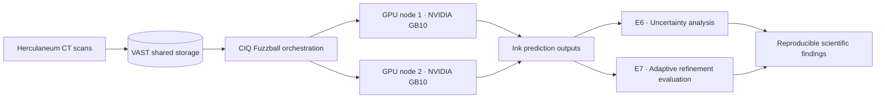
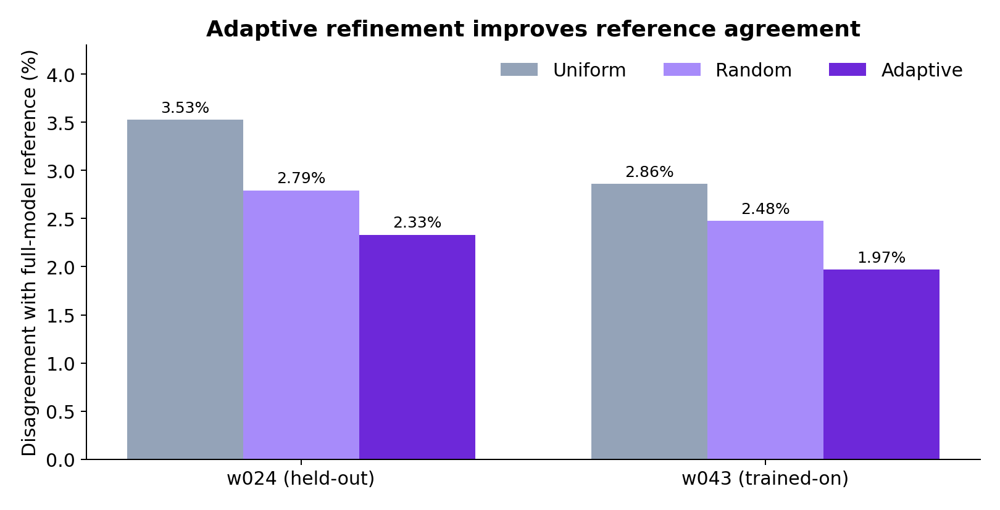

<div align="center">

# Project Prometheus

### Accelerating Ancient Scroll Discovery Through Distributed, Uncertainty-Aware AI

**CIQ Fuzzball Hackathon · Vesuvius Challenge**

*Distributed GPU inference · Reproducible science · Adaptive compute allocation*

> **The idea:** We cannot safely unroll the carbonized scrolls of Herculaneum. AI can help detect hidden ink in CT scans—but model predictions vary, and running many configurations is expensive. **Prometheus uses distributed GPU computing to investigate that uncertainty and test where additional computation is most valuable.**

## 📜 The Challenge 📜 

Nearly 2,000 years after the eruption of Mount Vesuvius, many carbonized papyrus scrolls from Herculaneum remain unreadable. Researchers use CT imaging and virtual unwrapping to investigate their contents without physically opening them. Distinguishing ancient ink from carbonized papyrus remains difficult.

Our focus is **not** to claim that we deciphered new text. We ask two practical questions:

1. **Which modeling choices cause ink predictions to change?**
2. **Can we prioritize expensive follow-up analysis where predictions are most uncertain?**

## ⚙️ Our Approach ⚙️ 



We evaluated **18 inference configurations**: two scroll sections × three model checkpoints × three CT depth windows. We then independently analyzed the resulting prediction images and evaluated an offline adaptive-refinement strategy.

## 📊 Results at a Glance 📊 

| Metric | Result |
|:--|--:|
| Distributed inference workloads | **18 jobs / 2 GPU nodes** |
| E6 experiment wall time | **909 seconds** |
| Estimated speedup vs. summed task runtimes | **1.61×** |
| Valid pixels analyzed across two sections | **86.8 million** |
| Checkpoint variation disagreement | **32.00%** (w024) · **29.77%** (w043) |
| Depth variation disagreement | **14.65%** (w024) · **12.36%** (w043) |
| E7 adaptive reduction in reference disagreement vs. random, six-pass budget | **16.5%** (w024) · **20.5%** (w043) |
| Independent reproducibility | **E6 metrics reproduced locally** |

*The 1.61× figure is an **estimate** based on summed task durations divided by observed experiment wall time; it is not a controlled single-node benchmark.*

## 🔬 Finding 1 — AI model choice matters 🔬


Changing the **model checkpoint** caused approximately **2.2–2.4× more binary prediction disagreement** than changing the CT depth window in our controlled three-configuration comparisons. This identifies a major source of model sensitivity and helps motivate systematic evaluation rather than relying on a single prediction.

**Important:** Disagreement measures differences among predictions, **not** whether a prediction correctly identifies real ink.

## 🎯 Finding 2 — Focus computation on contested regions 🎯



In an **offline adaptive-selection evaluation**, we used two pilot predictions to identify regions for further analysis. At a budget equivalent to six full inference passes, adaptive refinement produced **16.5% and 20.5% less disagreement with the full-model reference** than random tile selection on w024 and w043, respectively.

The strategy refined approximately **57% of usable tile area** while covering **72.7% and 74.8% of contested pixels**. At the smallest tested budget, adaptive selection was **not consistently better** than uniform allocation.

This supports the potential of **uncertainty-aware compute allocation**, but it does **not yet demonstrate measured GPU-time savings or better ground-truth ink accuracy**.

## 🔁 Finding 3 — Results are independently reproducible 🔁 

We reanalyzed the full-resolution E6 predictions outside the distributed environment and reproduced the reported metrics. The analysis uses an explicit valid-pixel mask, a strict ink threshold of `p > 0.5`, and consistent definitions for disagreement and score variability.

```bash
python -u scripts/compare_predictions.py \
  --input-root experiment_exports/fuzzball/E6-bulk \
  --output-root results/E6-independent-analysis \
  --chunk-rows 64
```

*This command assumes the experiment exports and Python dependencies are available locally.*

## 🌍 Scientific Significance and Impact 🌍

The Vesuvius Challenge is ultimately about recovering lost writing from fragile ancient scrolls. Our contribution addresses the **research workflow around ink detection**: distributing computationally demanding experiments, quantifying where predictions are sensitive, and exploring whether follow-up computation can be allocated more intelligently.

**Prometheus brings together scalable orchestration and scientific uncertainty analysis to help make future scroll research more efficient, transparent, and reproducible.**

---

<sub>**Scientific scope:** w024 is a held-out segment; w043 is a trained-on sanity-check segment, not an independent validation set. Prediction scores are uncalibrated. E7 comparisons use an AI-derived full-model reference, not verified ink labels. No new scroll decipherment or accuracy improvement is claimed.</sub>
