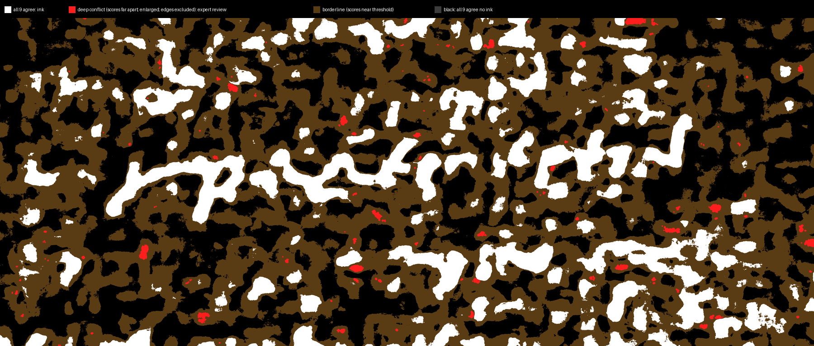
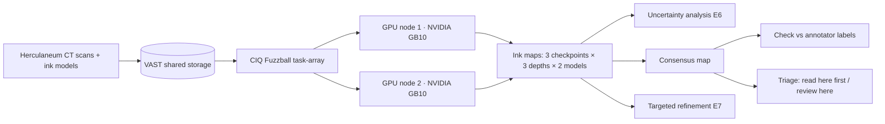
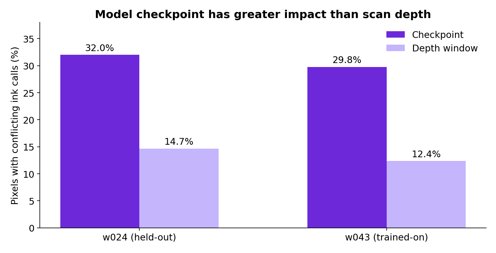
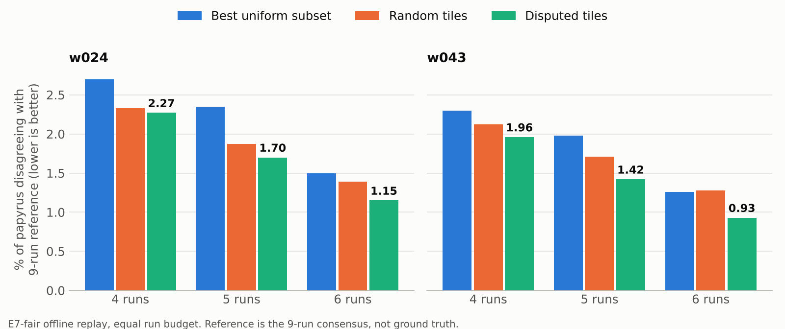

<div align="center">

# Project Prometheus

### Compute Where It Matters: scalable ensemble inference that maps where an ink-detection AI can be trusted

**CIQ Supercomputing Local AI Hackathon · SC26 Chicago · Team 5**

*CIQ Fuzzball · NVIDIA GB10 · VAST · Vesuvius Challenge*

</div>

> **The idea:** The carbonized scrolls of Herculaneum can't be safely unrolled. AI can find hidden ink in CT scans, but a single AI ink map looks equally confident everywhere, and checking it means running the model many ways. **Prometheus uses distributed GPU inference on CIQ Fuzzball to run the model many ways cheaply, then maps which ink strokes hold up and which don't.**



*Held-out segment w024 of PHerc. 0139, 9 runs of one model (`seed42`). **White:** ink in all 9 runs. **Brown:** borderline. **Red:** deep conflict, where runs strongly disagree. The triage figures later in this README use the stricter 18-run, two-model consensus.*

**Software stack:** RLC Pro AI 9.8 (CIQ) on both nodes · CIQ Fuzzball workflows, task arrays and Object Cache · VAST shared volume · NVIDIA GB10 with the NGC PyTorch 25.10 container (PyTorch 2.9.0).

## 📜 The Challenge 📜

Nearly 2,000 years after the eruption of Mount Vesuvius, many carbonized papyrus scrolls from Herculaneum remain unreadable. Researchers use CT imaging and virtual unwrapping to read them without opening them, and AI models to tell ink from papyrus.

Those ink maps depend on choices the reader never sees: which model checkpoint, which CT layers, even which training run. We do **not** claim to have deciphered new text. We ask:

1. **How much of a single ink map survives reasonable changes to those choices?**
2. **Does agreement between runs match what human annotators marked as ink?**
3. **Can extra compute and expert attention go only where runs disagree?**

## ⚙️ Our Approach ⚙️



We ran the public Vesuvius Challenge ink model ([`scrollprize/ink_9um`](https://huggingface.co/scrollprize/ink_9um)) in **9 configurations per segment** (3 checkpoints × 3 CT depth windows), for **two independently trained versions** of the model ([`hybrid_3d2d-seed42`](https://huggingface.co/scrollprize/ink_9um/tree/main/hybrid_3d2d-seed42) and [`hybrid_3d2d-seed43`](https://huggingface.co/scrollprize/ink_9um/tree/main/hybrid_3d2d-seed43), both in the same public repo; we used steps 10k, 40k and 75k of each), on three segments of PHerc. 0139 (w024 held out; w043 and w035 used in training and labeled).

Each run is one Fuzzball job on one GB10 GPU. Fuzzfiles stage the model and scans once onto a VAST volume, fan inference out across both nodes, then run analysis jobs on the same volume and export the results. Finished runs are skipped and every run checks that it read 17 CT layers, so failed workflows restart safely. Both nodes run CIQ's RLC Pro AI 9.8 (kernel `6.18.43-2.1.el9_clk`, verified per node), which provided the NVIDIA driver (580.173.02) and CUDA 13.0 with no setup on our side.

## 📊 Results at a Glance 📊

| Metric | Result |
|:--|--:|
| 18-run ensemble (2 segments × 9 configurations, `seed42`), default settings on 1 GPU | **~2.5 h** (estimated) |
| Same, after data-loader tuning (E5), 1 GPU | **24.6 min** (measured, 5.9× per run) |
| Same, two nodes via Fuzzball | **12.5 min** (measured) |
| Two-node speedup, same 18 jobs | **1.97×** (98.5% efficiency) |
| Per-job slowdown with both nodes reading VAST | **0.5%** |
| Two jobs per GPU (E8) | **2× throughput**, 13–22% less energy per run |
| Ink that all 9 runs agree on | **12.3%** (w024) · **5.9%** (w043) of the papyrus |
| Pixels changed by retraining with a new seed | **16–20%** |
| Precision vs annotator ink labels (w043, trained-on): single run → all 18 runs agree | **80.2% → 94.2%** |
| Recall vs the same labels: single run → all 18 runs agree | **64.6% → 34.8%** |
| Refining disputed tiles vs best uniform choice of runs (E7-fair) | **15–28% closer to the full 9-run ensemble** |
| First container pull (8.4 GB) vs cached start | **~50 min → 0.45 s** |

All speed numbers above are **measured** on the same 18 jobs, except the 2.5 h default-settings baseline, which is estimated from the measured 5.9× per-run speedup. Agreement-based rows trade recall for precision: unanimous ink is more often real, but covers about a third of labeled ink.

## 🖥️ Finding 1: Fuzzball, GB10 and VAST make ensembles routine 🖥️

An 18-run ensemble went from an estimated **2.5 hours** to a measured **12.5 minutes**:

- **Data-loader tuning (E5):** 5.9× faster per run (86 s).
- **Two nodes (scaling benchmark):** the same 18 jobs took **1,478 s** one GPU at a time and **750 s** across both nodes: **1.97×**, 98.5% efficiency. Scheduling overhead was 12–14 s, and outputs were identical.
- **Shared storage:** with both nodes reading VAST at once, the average job slowed by only 0.5% (81.4 → 81.8 s).
- **GPU packing (E8):** two jobs per GPU doubled throughput (2.0–2.1×), lifted GPU utilization from 23% to about 60% and cut energy per run 13–22%, with identical outputs.
- **Cold start:** the first pull of the 8.4 GB PyTorch container took about 50 minutes, mostly OCI-to-SIF conversion. Once cached, every job on either node started in 0.45 s, so pre-staging containers matters as much as pre-staging data.

That speed is what let us run, check and rerun ensembles many times in one hackathon day.

## 🔬 Finding 2: Only a small core of an ink map is stable 🔬



For every pixel we counted how many runs say "ink" and how much their scores vary, then sorted pixels into four zones: **agreed ink**, **agreed background**, **borderline**, and **deep conflict** (spread across runs > 0.2, edges excluded).

- **A typical single run marks 2.5–3.7× more ink than all 9 runs agree on.** Averaged over all 18 runs (both models), a single run marks 31.2% (w024) and 21.9% (w043) of the papyrus as ink; unanimous ink is 12.3% and 5.9%. The final checkpoint alone marks 26.0% on w024 (2.1×), the early 10k checkpoint 39.9% (3.2×).

- **Deep conflict is rare:** about 0.2% of the papyrus away from the edges, short enough for a human to review.
- **Checkpoint matters more than depth:** across 3 checkpoints, 32.0% / 29.8% of pixels have at least one run disagreeing; across 3 depth windows (±2 layers), 14.7% / 12.4% do. (This includes the early 10k checkpoint, which inflates the checkpoint effect.)

## 🧬 Finding 3: A second, independently trained model 🧬

The same model was trained twice with only the random seed changed. We ran `seed43` through the same 9 configurations on all three segments.

- **Retraining alone changes 16–20% of pixels**, even at the final checkpoints. Measured the same way, comparing one pair of runs at a time, that's about as much as changing checkpoint (19.7–21.4%) and twice as much as changing depth (9.3–9.9%). These pairwise figures are averages over every pair of runs, so they are lower than Finding 2's, which count a pixel if any of three runs disagrees.

- **Only 62–64% of one model's unanimous ink is unanimous in the other**, nearly identical on all three segments.
- **Ink that all 18 runs agree on:** 7.9% (w024) · 3.7% (w043) · 2.2% (w035) of the papyrus.

## ✅ Finding 4: Agreement matches annotators ✅

Annotator ink labels for w043 (sharded OME-Zarr v3, read with our own decoder), inside the labeled 1% of its papyrus:

| Prediction | Precision | Recall |
|:--|--:|--:|
| Base rate (share of labeled area that is ink) | 44.3% | – |
| Single run (75k checkpoint) | 80.2% | 64.6% |
| All 9 runs of one model agree | 92.1% | 43.0% |
| **All 18 runs of two models agree** | **94.2%** | 34.8% |

- Borderline pixels are ink 44.4% of the time, no better than chance in this region, yet hold 41% of labeled ink.
- Labeled ink where every run says "background" falls from 16% (one model) to 8.6% (two models). Those are shared blind spots that no amount of agreement can flag.
- w035's labels were very likely in training (single runs already score 98%), so it can't test accuracy.

## 🎯 Finding 5: Targeted refinement 🎯



**E7-fair (offline replay):** start from 3 runs (one per checkpoint), then add runs only on the most disputed 256 px tiles. At the same total budget, compare against **every** possible uniform choice of runs and against refining random tiles. The reference is the 9-run consensus, not ground truth.

| Budget (runs) | Best uniform | Random tiles | **Disputed tiles** |
|:--|--:|--:|--:|
| 4 | 2.70 / 2.30 | 2.33 / 2.12 | **2.27 / 1.96** |
| 5 | 2.35 / 1.98 | 1.87 / 1.71 | **1.70 / 1.42** |
| 6 | 1.50 / 1.26 | 1.39 / 1.28 | **1.15 / 0.93** |

*% of papyrus disagreeing with the 9-run reference, w024 / w043.*

- **Disputed tiles land 15–28% closer to the 9-run reference than the best uniform choice**, and 3–27% closer than random tiles. Random tiles also beat uniform, so part of the gain comes from mixing runs per tile and part from targeting.
- **Our first version, which used two pilot runs, did not beat a fair uniform baseline.** A teammate's review caught the unfair baseline; using one pilot per checkpoint fixed it.
- **E7b live replay:** a GPU run reproduced the offline result exactly. Masked runs took 60 s instead of 79 s, but per-run startup means area savings aren't yet GPU-time savings.

## 🧭 How Researchers Would Use It 🧭

The consensus map is a **triage**:

- **White = read here first.** Where all 18 runs of two models agree, annotators confirm ink 94% of the time, vs 80% for a single run. These strokes hold only about a third of labeled ink, so they're a starting point, not the whole text.
- **Red = review here first.** Under 0.2% of the papyrus, exported as a ranked list with positions. We propose these as the first candidates for expert review and new training labels. Testing that is the next step: no red areas fell inside the labeled region, so they are untested.
- **Black is not proof of blank papyrus.** 9–16% of labeled ink sits where every run says "no ink".

## 🔁 Reproducibility 🔁

We reanalyzed the full-resolution E6 predictions outside the cluster and reproduced the reported metrics, using an explicit valid-pixel mask, a strict ink threshold of `p > 0.5`, and the same definitions of disagreement and score spread.

```bash
python -u scripts/compare_predictions.py \
  --input-root experiment_exports/fuzzball/E6-bulk \
  --output-root results/E6-independent-analysis \
  --chunk-rows 64
```

*This command assumes the experiment exports and Python dependencies are available locally.*

On Fuzzball, each experiment is a Fuzzfile in `workflows/`, numbered in run order: staging, environment setup, the 18-run study, the scaling benchmark, GPU packing, consensus map, label check, cross-seed run, E7-fair, E7b and export. Paste one into **Edit Workflow** and press **Start**. Scroll data and model weights are not in this repo; the staging workflow downloads them from the Vesuvius Challenge open data and Hugging Face.

## ⚠️ Limitations ⚠️

- **Agreement is not correctness.** Both models share architecture and training data, and still share blind spots.
- **The label check is small and trained-on:** 1% of one segment that was used in training.
- **Thresholds** (0.5 for ink, 0.2 spread for deep conflict) are conventional, and scores are not calibrated probabilities.
- **E7** measures how well a cheaper ensemble reproduces the full one, not ink accuracy.
- **Scaling:** near-linear speedup is expected for independent jobs on two nodes. We did not test more nodes, compiled or low-precision inference (TensorRT, `torch.compile`, FP8), and GPU utilization was only 23–30% per unpacked job (23% in the E8 single-job test, 29–30% averaged over the scaling benchmark). `torch.compile` failed in the NGC container (Triton could not find the CUDA driver library), so all runs are uncompiled.

## 🚀 Next Steps 🚀

1. Validate on labeled segments **held out** from training.
2. **Label red areas, retrain, measure** whether the model improves more than with random labels.
3. Add more independently trained models.
4. **Whole-scroll consensus maps** on more nodes, with packed, compiled inference to remove per-run startup.

## 🌍 Scientific Significance and Impact 🌍

The Vesuvius Challenge is ultimately about recovering lost writing from fragile ancient scrolls. Our contribution is to the **workflow around ink detection**: making ensembles cheap enough to run routinely on Fuzzball, GB10 and VAST, showing that retraining alone changes about a fifth of an ink map, and turning that uncertainty into a map that tells researchers where to read first and where expert attention is most needed.

---

<sub>**Scientific scope:** w024 is held out; w043 and w035 were used in training and serve as sanity checks, not independent validation. Prediction scores are uncalibrated. E7 comparisons use an AI-derived reference, not verified ink labels. No new scroll decipherment or accuracy improvement is claimed. Data: Vesuvius Challenge open data (PHerc. 0139); model: `scrollprize/ink_9um`. Code we call (`villa` ink-detection) belongs to the Vesuvius Challenge and is not redistributed here.</sub>
